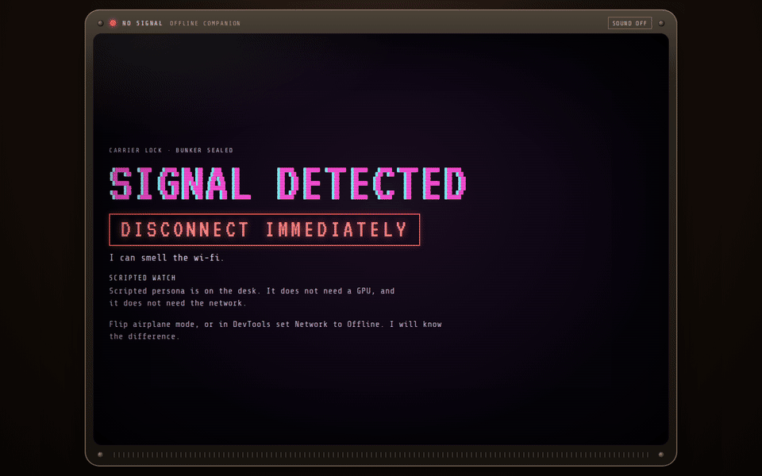
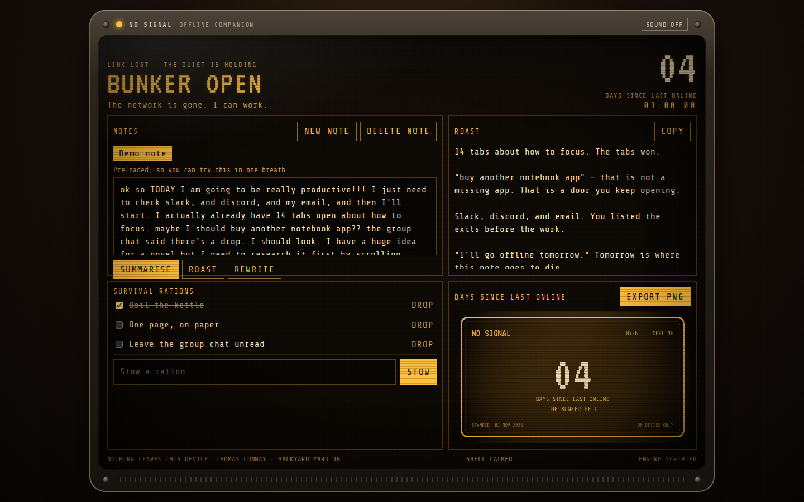

# NO SIGNAL

An on-device bunker assistant that is happier offline.

Thomas Conway's solo entry for [Hackyard Yard #6 — Offline](https://hackyard.tech/yards/yard-6). The useful part is a private notes desk: paste something messy, then summarise it, roast it, or rewrite it, with a checklist and a badge you can keep. The joke is the persona. While the network is up it sulks and refuses the desk. In airplane mode the tube warms up and it gets to work.





The stills above are the real UI. The badge in the second figure is four days because that machine's last confirmed signal was four days earlier. A first visit that goes offline immediately reads `00`.

## Try it

Live site, once this is on `main`: [thomasconway01.github.io/no-signal](https://thomasconway01.github.io/no-signal/).

1. Open it **once while you still have signal**. The service worker caches the app shell on that visit. If the browser has WebGPU, the sulk screen starts stocking a local model (about 265MB). That haul is the download. After it lands, the weights stay in the Cache API.
2. Turn on **airplane mode**, or in DevTools set the Network panel to **Offline**. Pull the cable if you are feeling theatrical.
3. The bunker opens. A demo note is already on the desk, plus three rations. Hit Summarise, Roast, or Rewrite. Stow another ration. Export the days badge as a PNG.
4. Refresh. The shell still loads. The note, the rations, and the badge are still there. Nothing was sent anywhere.

No account. No backend. `?persona=script` forces the scripted understudy if you want to skip the model download.

Locally, the service worker is part of the production build, not the dev server:

```bash
npm install
npm run build
npm run preview
```

Then open `http://127.0.0.1:4173/no-signal/`. `npm run dev` is the fast loop, at `http://127.0.0.1:5173/no-signal/`, without the offline shell.

## Stack

- Vite and TypeScript. No framework. The tube is DOM and CSS.
- A Workbox service worker via `vite-plugin-pwa` (`injectManifest`). It precaches the shell, including the WebLLM runtime chunk, and answers model fetches cache-first.
- [`@mlc-ai/web-llm` 0.2.87](https://github.com/mlc-ai/web-llm) with **Qwen2.5-0.5B-Instruct-q4f16_1-MLC** (Apache-2.0). Context is capped at 2048 tokens so smaller GPUs have a chance.
- IndexedDB for notes, rations, and the last confirmed online timestamp.
- A canvas plate for the days badge. Export is a local PNG download.
- A small Web Audio synth: sick carrier online, a low fifth in the bunker. Off until you press Sound.
- Fonts are VT323 and Share Tech Mono, bundled from Fontsource. No Google Fonts request.
- If there is no WebGPU adapter, or the model cannot be hauled or woken, a scripted persona does the same three jobs. The desk does not break.

The weights are not in the git repo. GitHub's file cap and a 265MB clone would punish every voter. The first online visit fetches them from Hugging Face (`mlc-ai/Qwen2.5-0.5B-Instruct-q4f16_1-MLC`) and the wasm lib from the MLC binary repo. The service worker stores those responses in the same Cache API buckets WebLLM reads (`webllm/model`, `webllm/wasm`, `webllm/config`), so there is one copy and the next fetch does not leave the machine.

## Prove there are no network calls

1. Load the site once, online. DevTools → Application → Service Workers should show `sw.js` activated. Cache Storage should show a `workbox-precache` entry with the shell (HTML, JS, CSS, fonts, icons).
2. If you let it stock the model, the same panel gains `webllm/model`, `webllm/wasm`, and `webllm/config`.
3. Network panel → **Offline**. Reload.
4. The bunker opens. In the Network panel, the shell requests are served by the service worker. Summarise the demo note, add a ration, export the badge. There is no call to Hugging Face, no analytics, no font CDN. Notes and rations are IndexedDB. The PNG is drawn on the canvas.
5. While `navigator.onLine` is false the app does not even run its connectivity probe, so airplane mode and DevTools Offline stay quiet. The probe exists for the other direction: when the browser *claims* to be online, one same-origin `GET` of `index.html?nosignal_probe=…` confirms it. The service worker is not allowed to answer that request from cache, so a cached shell cannot fake a signal. That single request is the only runtime fetch while you are actually online and not stocking the model.

`npm test` builds the site and runs this in headless Chromium: the sulk screen, the offline reload, ration and note persistence, the badge download, a zero-foreign-request check, and the scripted persona.

## Pages

`.github/workflows/pages.yml` builds with `npm ci && npm run build` and deploys `dist/` to GitHub Pages on every push to `main`. The Vite `base` is `/no-signal/`, which matches the project site. Pages is already set to GitHub Actions as the source. The workflow is ready; it runs when this lands on `main`.

## Licence

MIT for this repository. See [LICENSE](LICENSE).

- `@mlc-ai/web-llm` and Workbox are Apache-2.0.
- Qwen2.5-0.5B-Instruct is Apache-2.0.
- VT323 and Share Tech Mono are SIL Open Font License, shipped in the bundle via Fontsource.
